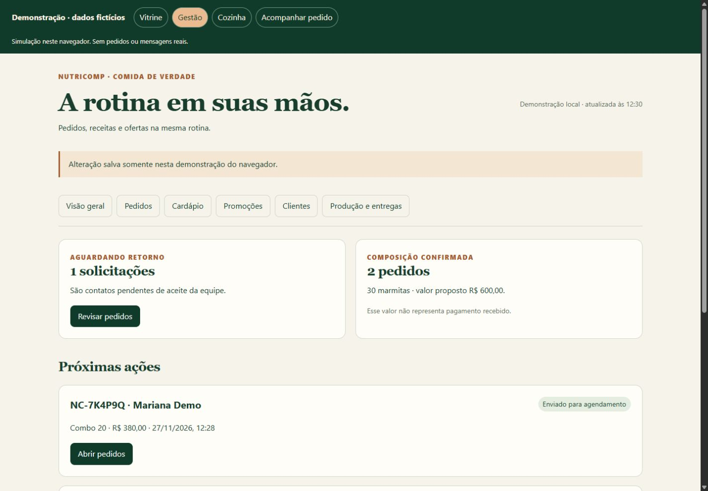
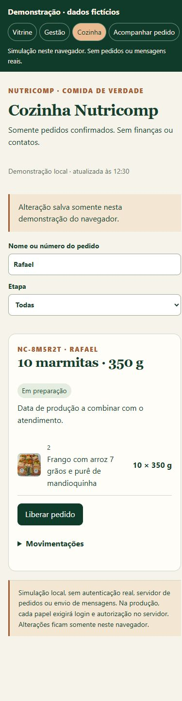

# Nutricomp | Demonstração integrada para aprovação

27/11/2026. Prévia estática e isolada, com dados fictícios. A home reaproveita a Sprint 0; o domínio oficial e a HostGator permanecem intactos.

- [Vitrine](https://nutricomp-demonstracao-2026.contato-ellobordados.chatgpt.site/) · [Gestão](https://nutricomp-demonstracao-2026.contato-ellobordados.chatgpt.site/gestao/) · [Cozinha](https://nutricomp-demonstracao-2026.contato-ellobordados.chatgpt.site/cozinha/) · [Acompanhamento](https://nutricomp-demonstracao-2026.contato-ellobordados.chatgpt.site/pedido/acompanhar/)

## Abrir a experiência

- [Vitrine](https://nutricomp-demonstracao-2026.contato-ellobordados.chatgpt.site/)
- [Gestão](https://nutricomp-demonstracao-2026.contato-ellobordados.chatgpt.site/gestao/)
- [Cozinha](https://nutricomp-demonstracao-2026.contato-ellobordados.chatgpt.site/cozinha/)
- [Acompanhamento fictício](https://nutricomp-demonstracao-2026.contato-ellobordados.chatgpt.site/pedido/acompanhar/)

As alterações ficam no armazenamento deste navegador e origem. Outro aparelho começa com os exemplos iniciais; não há sincronização entre pessoas, autenticação real, banco de pedidos ou envio de mensagens. Use exclusivamente dados fictícios. A navegação entre papéis é um recurso da demonstração.

## Roteiro em cinco minutos

1. Na vitrine, selecione 30/20/10 ou use o assistente, ajuste os pratos e visualize a mensagem. O mesmo envio repetido conserva o registro demonstrativo. Abra a gestão: a nova solicitação aparece, sem contar como venda ou pagamento.
2. Em Cardápio, adicione um prato fictício, bloqueie e reative. A vitrine passa a usar a disponibilidade local. Ao finalizar uma cesta antiga, uma receita bloqueada exige substituição e nova revisão. Receitas sob cotação ficam fora da seleção automática.
3. Em Promoções, crie desconto em R$ ou %, com início/fim em São Paulo. Uma campanha por combo/período, sem acumular. A vitrine atualiza o total e a economia; a base 510/380/220 e os preços já registrados em pedidos são preservados.
4. Confirme uma solicitação na gestão. Na cozinha, pesquise pelo primeiro nome fictício ou código e avance: recebido → em preparação → liberado → enviado para agendamento. Cada ação registra um evento local. A fila logística surge após o encaminhamento; agendamento, pagamento e entrega continuam separados.
5. Abra o acompanhamento e selecione os exemplos de e-mail. O botão de WhatsApp apenas prepara texto para revisão, sem abrir conversa ou enviar. No produto real, essa página exigirá token longo, privado e revogável; o código curto não será uma senha.

## O que existe e o que depende de implementação real

| Situação | Entrega |
| --- | --- |
| Implementado na prévia | Home reutilizada, navegação entre papéis, seleção/assistente/checkout local, gestão de pratos/disponibilidade, promoções datadas, pedidos sintéticos, cozinha em sequência, fila de agendamento, acompanhamento e prévias de avisos. |
| Persistência demonstrativa | Somente localStorage deste navegador. Não constitui histórico operacional da Nutricomp, proteção de acesso ou validação de preço no servidor. |
| Ainda pendente | PHP/PDO_SQLite comprovado na HostGator, login/perfis/CSRF, banco privado, APIs transacionais, conflitos entre operadores, idempotência no servidor, tokens privados, SMTP/fila de e-mails, retenção e backup/restauração. |
| Condicional | WhatsApp automático só com plataforma oficial, consentimento, avaliação de custo e autorização. |

## Verificação realizada

- `node --check` nos scripts e `node test-demo.cjs`: centavos, limites de vigência, desconto percentual, chave repetida, prato bloqueado, confirmação comercial, quatro etapas e pagamento separado.
- Navegador: cadastrar receita fictícia; montar Combo 30 pelo assistente; salvar solicitação local; pesquisar Mariana na cozinha; avançar os quatro estados; visualizar o acompanhamento e preparar o texto sem envio; criar promoção de R$30 e observar Combo 30 por R$480 (R$16/unidade).
- Capturas reais: [gestão desktop](nutricomp-demo/gestao-desktop.jpg) e [cozinha mobile](nutricomp-demo/cozinha-mobile.jpg). Revisão móvel sem rolagem lateral da página. A Sprint 0 contém a validação 360/390/768/1440 e as capturas da home original.
- Limites: não houve teste de backend/SMTP, servidor HostGator, Lighthouse, Search Console ou auditoria completa WCAG. A identidade exata do código de produção e o ZIP administrativo continuam pendentes. As fotos dependem de URLs públicas da marca.

## Dez prioridades SEO

As evidências de produção abaixo provêm da auditoria da Sprint 0, em 27/11/2026. Nenhuma correção foi aplicada ao domínio oficial. [Auditoria e fontes](nutricomp-sprint-0/README.md).

| Ação | Impacto / esforço | Evidência e estado |
| --- | --- | --- |
| Noindex da área antiga de teste | Alto / baixo | Raiz e /nutricomp-novo/ tinham HTML idêntico e indexável. Proposta para produção; demo nova tem meta noindex e cabeçalho configurado. |
| Redirecionar variantes ao domínio canônico | Alto / médio | Variantes HTTP/www respondiam 200. Correção de produção pendente. |
| Cardápio útil no HTML inicial | Alto / médio | Catálogo público dependia de JS. Prévia mantém essa dependência; renderização inicial pendente no backend. |
| Medir e otimizar imagem LCP | Alto / médio | Hero WebP auditado com 217.916 bytes e preload. Medição real pendente. |
| Relevância local e oferta 350 g | Alto / baixo | Title da demo menciona marmitas congeladas 350 g e São Paulo; home explica oferta. Revisão comercial da produção pendente. |
| Conferir schema e dados comerciais | Médio / baixo | Produção tinha LocalBusiness/WebSite. Não acrescentamos avaliações nem dados inventados; validação cadastral pendente. |
| Sitemap só com URLs canônicas úteis | Médio / baixo | Sitemap auditado listava home/privacidade. Demo privada de operação não entra no sitemap de produção. |
| Instruções de conservação/aquecimento | Médio / médio | Proposta editorial: publicar somente instruções validadas pela equipe. |
| Páginas permanentes de combos/entrega | Médio / médio | Proposta para conteúdo original e links internos; depende de regras de entrega confirmadas. |
| Search Console e acompanhamento por dispositivo | Alto / médio | Proposta de medição: indexação, canônicas, cliques/CTR e início de montagem; sem promessa de posição. |

## Implementação após aprovação

1. Identificar/recuperar versão exata da produção. Com aprovação de homologação, verificar PHP 8.x, `PDO::getAvailableDrivers()` contendo sqlite e diretório persistente gravável fora de `public_html`, exclusivo do ambiente de teste.
2. Entregar login/papéis, sessões seguras, CSRF, limites e registro idempotente de solicitações, com preços recalculados no servidor e fallback honesto de WhatsApp. Comprovar dois POSTs → um registro e bloqueio de acesso anônimo.
3. Acrescentar cozinha com máquina de estados, versão de pedido e eventos transacionais; depois catálogo/bloqueios e promoções com snapshots e validação no servidor.
4. Implantar tokens privados e outbox idempotente de e-mail. Validar SMTP/TLS/SPF/DKIM e limites com testes autorizados; falha de envio não reverte preparo. Depois CRM, produção, CSV protegido e logística.
5. Antes de instalar: backup fora da web, restauração comprovada, revisão de arquivos/caminhos/permissões, teste sintético isolado, aprovação da homologação e plano de reversão. Promoção à raiz exige nova autorização expressa.

**Próxima única ação:** responsável Nutricomp aprovar a experiência integrada ou indicar ajustes, antes de implementar o backend real.
