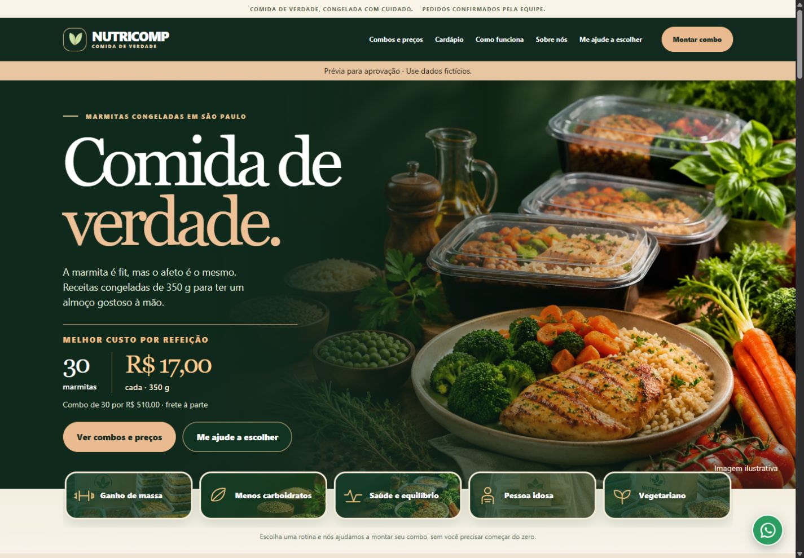
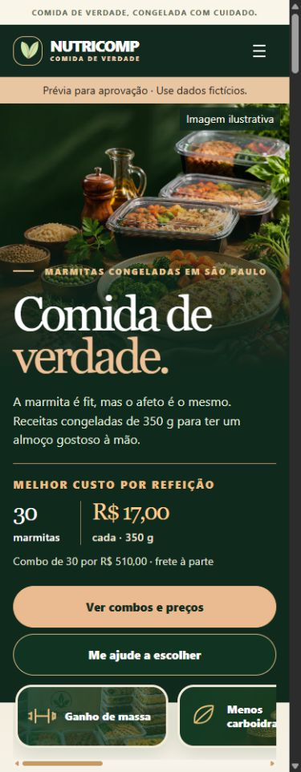

# Nutricomp | Sprint 0 — home premium e auditoria SEO

## Prévia navegável

Baixe [previa.html](previa.html) pelo botão **Download raw file** do GitHub e abra o arquivo no navegador. O mesmo arquivo se adapta ao computador e ao celular. As fotografias são carregadas do domínio oficial. Use dados fictícios para montar um combo, avançar pelo assistente e visualizar a mensagem de pedido na página. Os controles de WhatsApp e a busca externa por CEP estão em modo de demonstração.

### Capturas e revisão visual · 27/11/2026

Prévia revisada no navegador nas larguras 360, 390, 768 e 1440 px. A página não apresentou rolagem horizontal; a faixa de perfis conserva sua rolagem interna no celular. O contato flutuante foi ocultado até 830 px para não cobrir os controles; o contato continua disponível no rodapé. Também foi corrigida a perda de foco ao ajustar pratos e escolher um perfil no assistente.

[Captura desktop · 1440 × 1000](captura-desktop.jpg) · [Captura celular · 390 × 844](captura-mobile.jpg)

### Antes e depois

- **Home de referência pública.** Abre com “Comer bem. Viver leve.”, sobreposição verde mais densa, oferta em um bloco fechado e três colunas de combos de mesma largura. O catálogo visível depende de JavaScript.
- **Prévia.** Abre com “Comida de verdade”, mostra mais da fotografia gastronômica e coloca 30 marmitas, R$ 17,00 cada e 350 g no mesmo bloco. O total de R$ 510,00 fica na linha seguinte. O Combo 30 ganha mais espaço no computador, com 20 e 10 na sequência. No celular, a foto abre a página e os combos ficam em coluna. O assistente conserva as etapas de quantidade, objetivo e sugestão, seguidas da finalização simulada.
- **Hipótese.** Explicar a oferta antes da rolagem e dar entradas distintas para comparar preços e receber ajuda pode aumentar a proporção de visitantes que iniciam a montagem. Após uma eventual aprovação e publicação, medir início de combo, avanço no assistente e abertura do WhatsApp por dispositivo. Contabilizar confirmação da equipe separadamente.

## Evidência de produção em 27/11/2026

A raiz HTTPS com www respondeu 200 e usa CSS e JS externos, o H1 “Comer bem. Viver leve.” e imagens WebP locais. A referência versionada é estruturalmente diferente, com CSS incorporado e versões da proposta que incluem fotos externas. A versão exata em produção segue sem commit identificado e o ZIP recente do painel segue fora da branch. Gestão retornou 404. A Sprint 0 trabalhou com os arquivos públicos da home e deixou a HostGator intacta. [Home oficial](https://www.nutricomp.com.br/) · [Referência versionada](https://github.com/nexoneuropro-bot/gabriel/tree/codex-nutricomp-handoff-2026/hostgator)

## Prioridades SEO

| Prioridade | Evidência e ação para uma futura publicação |
| --- | --- |
| P0 · Área de teste | A raiz e `/nutricomp-novo/` retornaram 200 e têm HTML idêntico byte a byte, com robots indexável. Aplicar `noindex` à área de teste se ela precisar continuar pública, mantendo a leitura liberada ao Google até a remoção do índice. Se desativada, redirecionar para a página equivalente. Confirmar na inspeção de URL. |
| P0 · Domínio canônico | A home declara a variante HTTPS com www. HTTP com e sem www e HTTPS sem www responderam 200 sem redirecionar. Configurar redirecionamentos permanentes diretos para a variante canônica e checar status, sitemap e links internos. |
| P1 · Cardápio no HTML | O contêiner do cardápio vem vazio e é preenchido por JS. Entregar em HTML nomes e categorias de receitas confirmadas, com contexto de disponibilidade. Conferir o HTML original e o renderizado no Search Console. |
| P1 · Imagem principal | O WebP principal tem 217.916 bytes e preload na raiz. Medir LCP em celular antes de trocar o carregamento. Testar variantes por largura e manter dimensões explícitas e lazy loading nas imagens secundárias. Acompanhar LCP ≤ 2,5 s, INP ≤ 200 ms e CLS ≤ 0,1 no P75 onde houver dados. |
| P1 · Relevância local | Title e descrição já citam o produto, e o title cita São Paulo. Alinhar o H1 e o texto inicial a marmitas congeladas de 350 g e publicar orientações verificadas de entrega/retirada, conservação e aquecimento. Começar na própria home. |
| P1 · Dados estruturados | A raiz já contém LocalBusiness e WebSite. Validar nome, endereço, CEP, contato e horários com a equipe antes de ajustar o schema. Incluir ofertas estruturadas somente quando refletirem preços e disponibilidade confirmados. |
| P2 · Sitemap e medição | Robots e sitemap responderam 200. O sitemap lista a home e a política de privacidade, sem a área de teste. Conferir se cada URL listada é canônica e indexável, e usar Search Console para acompanhar cobertura, consultas locais, cliques e CTR. |

Fontes públicas: [área de teste](https://www.nutricomp.com.br/nutricomp-novo/) · [robots.txt](https://www.nutricomp.com.br/robots.txt) · [sitemap.xml](https://www.nutricomp.com.br/sitemap.xml) · [guia do Google](https://developers.google.com/search/docs/fundamentals/seo-starter-guide) · [Core Web Vitals](https://web.dev/articles/vitals/)

## Verificação e limites

- GET público para raiz, variantes de domínio, área de teste, gestão, robots, sitemap, privacidade e imagens referenciadas. Comparação SHA-256 de raiz e área de teste.
- `node --check` no JavaScript. Teste em Node com DOM simulado para 30/20/10, todos os perfis de sugestão, ajuste manual com limite de dois pescados, resumo de 350 g sem documentos nem opt-in por padrão, âncoras e noindex. Nenhuma mensagem enviada.
- Continuação de 27/11/2026: prévia servida localmente e revisada no navegador em 360/390/768/1440 px. Em cada largura, `scrollWidth` da raiz foi igual a `clientWidth`. Revisados hero, menu móvel, combos, sugestão e finalização simulada. Capturas acima obtidas da prévia corrigida.
- Navegador: combos 10/20/30 com R$ 220/R$ 380/R$ 510; limite de dois peixes; sugestão com 30 unidades conservada no resumo; opt-in desmarcado; mensagem exibida apenas na página com dados fictícios. Teclado: skip link com foco visível, Tab dentro do assistente, Escape fecha e devolve foco. Foco preservado no perfil e nos steppers, inclusive ao chegar a zero ou ao limite. `noindex,nofollow` conferido. `node --check` passou após as correções.
- Limites: revisão visual e funcional da prévia, sem auditoria completa WCAG, Lighthouse, Search Console ou backend real. Fotos ainda dependem do domínio oficial. O commit de produção e o ZIP administrativo continuam sem recuperação; a HostGator não foi alterada.
- Próxima ação única: responsável Nutricomp aprovar ou apontar ajustes na prévia da Sprint 0 antes de iniciar a Sprint 1.
